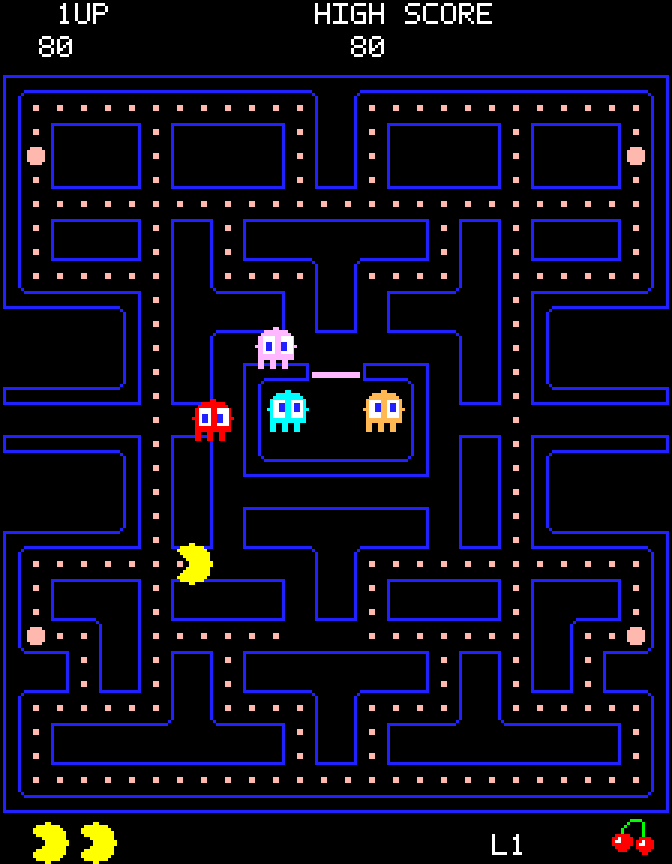

# Chompit

A playable maze chase written in Idris 2 with [idris2-sdl3](https://github.com/ska80/idris2-sdl3).
Idris 2 is indeed pacman-complete.

<p align="center">
  
</p>

Chompit uses the classic 28 × 31 maze, arcade palette, wraparound tunnel, and four ghost
personalities.  The game renders its own pixel art and bitmap font.  The repository includes
original arcade-style effects, a title tune, and short musical cues in `assets/sounds/`.  A Python
script can regenerate these files.  No ROM, sampled arcade audio, external font, or downloaded asset
is required.

This is a playable first version, not a cycle-accurate reproduction.  Ghost release timers and some
level rules differ from the arcade game.  The generated melodies and waveforms are original, not
exact copies.  Remaining fidelity work is listed in [TODO.md](TODO.md).

## Build and play

Keep both repositories next to each other:

```text
projects/
  idris2-chompit/
  idris2-sdl3/
```

Install these requirements:

- Idris 2 0.8.0 or later, Chez Scheme, and pack.
- GNU Make, a C compiler, and pkg-config.
- SDL3 development files, version 3.2.12 or later.
- SDL3_mixer development files, version 3.2.0 or later.

The pkg-config package names are `sdl3` and `sdl3-mixer`.  SDL3_image and SDL3_ttf are not required.
Python 3 is required only for tests and audio regeneration.  The build follows the sibling library's
Chez-only scaffold.  See its [build
guide](https://github.com/ska80/idris2-sdl3/blob/master/docs/build.md) for native dependencies.
Linux x86-64 is the tested platform.

From this repository's root, run:

```sh
make run
```

`make` builds the local SDL packages and `build/exec/chompit`.  The game uses the bundled WAV files
in `assets/sounds/`.  Run `make assets` only when you want to regenerate those tracked files.  `make
run` also sets the native library search path and preserves your existing `LD_LIBRARY_PATH`.  Run
these commands from the repository root because default audio paths are relative to that directory.
To use another library checkout, update `pack.toml` and pass `SDL_ROOT=/absolute/path` to Make.

To play without opening an audio device, run:

```sh
make run ARGS="--silent"
```

To use another directory of WAV files, run `make run ARGS="--assets /absolute/path"`.  Keep the
filenames listed in [assets/README.md](assets/README.md).  `make clean` removes local build output,
but preserves the bundled sounds and leaves the sibling library unchanged.

## Controls and rules

| Key | Action |
| --- | --- |
| Enter or Space | Start or retry after game over |
| Arrow keys or WASD | Move and queue the next turn |
| P | Pause or resume |
| M | Mute or restore sound |
| Escape or Q | Quit |

Movement continues without a held key.  Turns wait until the next legal junction, and reversals work
between junctions.  The game pauses when its window loses keyboard focus.  Press P to resume after
you return.  The resizable window preserves the 224 × 288 display proportions.

Each maze contains 240 dots worth 10 points and four power pellets worth 50 points.  Power pellets
turn hunting ghosts blue for a limited time.  Consecutive captures score 200, 400, 800, then 1,600
points.  Captured eyes return to the house and regain their bodies.  Revived ghosts resist the
current power pellet, but another power pellet removes that protection.

Red targets the player, and pink targets four tiles ahead.  Cyan uses the player's direction and
red's position.  Orange chases from a distance and retreats when it gets close.  Ghosts alternate
between chase and scatter, a mode that targets their home corners.  The pink and cyan targets retain
the arcade game's upward look-ahead quirk.

You start with three lives and earn one extra life at 10,000 points.  Bonus fruit appears after 70
and 170 pellets, and disappears after ten seconds.  Its value increases with the level.  Clearing
the maze starts another level with higher speed and a new set of pellets.  The high score survives
retries in the same process, but is not saved to disk.

## Tests and source

Run the full local suite:

```sh
make test
```

The test package is `test/chompit-test.ipkg`, and its Idris and Python sources are in `test/src/`.
The Idris tests depend on the `chompit` package and build into `test/build/`.  `make clean` removes
both the game and test build output.

The suite tests maze reachability, movement, ghost targets, collisions, scoring, timers, input
mapping, and state changes.  It also compares bundled WAV files with regenerated audio and runs 450
scripted frames with dummy SDL devices.  A second run tests the silent path.  The smoke runs
exercise drawing and audio calls, but do not assess sound quality on speakers.  Run `make smoke` for
those runs alone.

The simulation does not use SDL or perform I/O.  Rendering, input, and audio stay outside it.  See
[docs/design.md](docs/design.md) for module boundaries and resource cleanup.  Project code and
generated assets use the [MIT License](LICENSE).  Chompit is an independent project, not an official
Pac-Man release.
