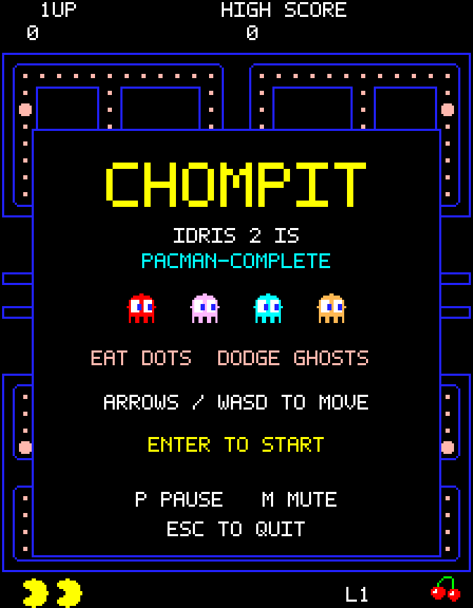

# Chompit

A playable maze chase written in Idris 2 with [idris2-sdl3](https://github.com/ska80/idris2-sdl3).
Idris 2 is indeed pacman-complete.

<p align="center">
  
  
</p>

Chompit has five 28 × 31 mazes: the classic layout and four original layouts.  It keeps the arcade
palette, wraparound tunnel, and four ghost personalities.  The game renders its own pixel art and
bitmap font.  The repository includes original arcade-style effects, title and gameplay music, and
short musical cues in `assets/sounds/`.  A Python script can regenerate these files.  No ROM,
sampled arcade audio, external font, or downloaded asset is required.

Chompit follows the arcade speed tables, pellet-based ghost releases, and later-level chase
schedules.  Ghosts reverse at the next tile center and use level-specific warning flashes.  It is
not a cycle-accurate reproduction.  Turning, collisions, and animation still use simpler rules.  The
generated melodies and waveforms are original, not exact copies.  See [arcade
rules](docs/arcade-rules.md) for the tables and differences, and [TODO.md](TODO.md) for remaining
work.

## Build and play

Keep both repositories next to each other:

```text
projects/
  idris2-chompit/
  idris2-sdl3/
```

Install these requirements:

- Idris 2 0.8.0 or later, Chez Scheme, and pack.
- GNU Make, a C compiler, and pkg-config.
- SDL3 development files, version 3.2.12 or later.
- SDL3_mixer development files, version 3.2.0 or later.

The pkg-config package names are `sdl3` and `sdl3-mixer`.  SDL3_image and SDL3_ttf are not required.
Python 3 is required only for tests and audio regeneration.  The build follows the sibling library's
Chez-only scaffold.  See its [build
guide](https://github.com/ska80/idris2-sdl3/blob/master/docs/build.md) for native dependencies.
Linux x86-64 is the tested platform.

From this repository's root, run:

```sh
make run
```

`make` builds the local SDL packages and `build/exec/chompit`.  The game uses the bundled WAV files
in `assets/sounds/`.  Run `make assets` only when you want to regenerate those tracked files.  `make
run` also sets the native library search path and preserves your existing `LD_LIBRARY_PATH`.  Run
these commands from the repository root because default audio paths are relative to that directory.
To use another library checkout, update `pack.toml` and pass `SDL_ROOT=/absolute/path` to Make.

To play without opening an audio device, run:

```sh
make run ARGS="--silent"
```

To use another directory of WAV files, run `make run ARGS="--assets /absolute/path"`.  Keep the
filenames listed in [assets/README.md](assets/README.md).  `make clean` removes local build output,
but preserves the bundled sounds and leaves the sibling library unchanged.

## Controls and rules

| Key | Action |
| --- | --- |
| Enter or Space | Start, retry, or skip an intermission |
| Arrow keys or WASD | Move and queue the next turn |
| P | Pause or resume |
| M | Mute or restore sound |
| Escape or Q | Quit |

Movement continues without a held key.  Queue a turn before a junction to cut the corner along a
diagonal path.  You can also turn shortly after passing the center.  Reversals work between
junctions.

The game pauses when its window loses keyboard focus.  Press P to resume after you return.  The
resizable window preserves the 224 × 288 display proportions.

A quiet music loop accompanies active play.  It fades out after death or level completion.  P pauses
the music with the game, and M mutes music and effects together.  Four siren variants follow the red
ghost's hunting speed.  A separate warning plays while captured eyes return to the house.

Dots score 10 points, and each maze has four power pellets worth 50 points.  The first maze has 240
dots, with different counts in the other layouts.  Power pellets turn ghosts blue for a limited
time, with white flashes before protection ends.  The flash count follows the level number.

Consecutive captures score 200, 400, 800, then 1,600 points.  Captured eyes return to the house and
regain their bodies at their own positions.  Revived ghosts resist the current power pellet, but
another power pellet removes that protection.

Red targets the player, and pink targets four tiles ahead.  Cyan uses the player's direction and
red's position.  Orange chases from a distance and retreats when it gets close.  Ghosts alternate
between chase and scatter, a mode that targets their home corners.  The pink and cyan targets retain
the arcade game's upward look-ahead quirk.

Normal ghosts cannot turn upward at four specific junctions in the classic maze.  The same
restriction applies to matching junctions in the other layouts, but not to corners.

Waiting ghosts move up and down inside the house.  Pellet counts control when they leave, and a
timer releases them if you stop eating.  They move sideways to the door's center, then leave through
it.  Red speeds up twice near maze completion and then keeps chasing during scatter.  After level
twenty, the player slows down again.

Mode changes and power pellets request a reversal at the next tile center.  Multiple requests before
that arrival share one reversal.  Power pellets request reversals on every level, but provide no
protection at level seventeen or from level nineteen onward.

You start with three lives and earn one extra life at 10,000 points.  Bonus fruit appears after 70
and 170 pellets, and disappears after ten seconds.  Its value and artwork follow eight bonus tiers,
from cherries to the key.  The maze bonus and the icon below the maze always show the current tier.

Collect every dot and power pellet to complete a level.  A completion animation and a short ready
countdown separate levels.  Your score and lives carry over automatically.

An intermission is a short animation between levels.  Three scenes appear after levels 2, 5, 9, 13,
and 17, with the third scene repeating.  Each lasts eight seconds, with one shared music loop in
place of gameplay audio.  Enter or Space skips the scene, P pauses it, and M mutes it.  Enter does
not skip a paused scene.  The next maze loads when the scene ends or you skip it.

After level five, the layouts repeat from the first maze.  The level number keeps rising, and
difficulty does not reset.  A retry after game over starts at level one.

## Saved high scores

The game reads the saved high score at startup.  On Linux, it uses
`$XDG_STATE_HOME/chompit/high-score`.  If `XDG_STATE_HOME` is unset, empty, or relative, it uses
`$HOME/.local/state/chompit/high-score` instead.  The game saves new records after death, level
completion, pause, or exit.

Empty, malformed, oversized, and out-of-range score files load as zero.  If storage fails, the game
prints a warning and keeps the high score in memory for that session.  The default score path stays
outside the repository, and `make clean` preserves it.

To play without reading or writing a saved score, run:

```sh
make run ARGS="--no-save"
```

## Tests and source

Run the full local suite:

```sh
make test
```

The test package is `test/chompit-test.ipkg`, and all test sources are in `test/src/`.  The Idris
tests depend on the `chompit` package and build into `test/build/`.  `make clean` removes both the
game and test build output.

The suite tests all five mazes, movement, ghost targets, collisions, scoring, timers, input mapping,
automatic level changes, bonus icons, and audio transitions.  `test/src/Arcade.idr` adds
speed-table, release-counter, mode-boundary, and restricted-turn tests.  `test/src/GhostTiming.idr`
tests delayed reversals across all layouts and each level's complete warning sequence.
`test/src/House.idr` tests house paths, movement boundaries, revival, and returning-eyes audio.
`test/src/Cornering.idr` tests early and late turns, diagonal paths, collisions, and movement limits.
`test/src/Intermissions.idr` tests scene timing, frozen game state, controls, and music transitions.

Audio tests compare bundled WAV files with regenerated audio.  They also test warning-loop speeds,
the music level, and the join between repeats.  Score tests use temporary directories and drive the
normal game through start, movement, and quit.  They do not touch your saved score.

A smoke test runs a short scripted game with dummy SDL devices.  The audio and silent runs each draw
2,505 frames through level thirteen, covering all layouts, bonus icons, warning loops, and retry.
They exercise delayed reversals and warning colors, then play all three intermissions to completion.
Each scene includes pause and mute.  Later segments follow all four ghosts through house entry,
revival, and departure.  They also draw early and late player turns on both axes, including pause
and reversal during a diagonal.

Smoke mode never reads or writes saved scores.  These runs do not assess sound quality or latency on
speakers.  Run `make smoke` for those runs alone.

The simulation does not use SDL or perform I/O.  Rendering, input, and audio stay outside it.  See
[docs/design.md](docs/design.md) for module boundaries and resource cleanup.  Project code and
generated assets use the [MIT License](LICENSE).  Chompit is an independent project, not an official
Pac-Man release.
